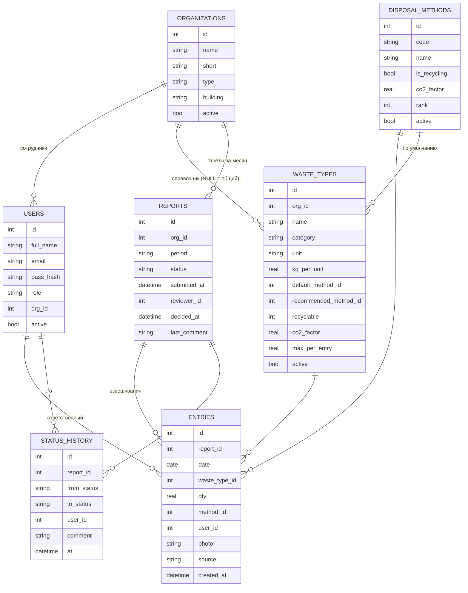

# Wasteless — учёт пищевых отходов для компаний и дома

Wasteless начинался как MVP для трека 1 хакатона ATU «Smart Food Industries» (победитель) и вырос в приложение для всех:
- **компании** (общепит, столовые, производство, ритейл, вузы) регистрируются сами, приглашают сотрудников по ссылке и ведут учёт по подразделениям с проверкой отчётов, реестром, аналитикой и прогнозом «сколько готовить»;
- **обычные люди** ведут домашний учёт: пишут, что выбросили (или присылают фото), а Wasteless считает килограммы, тенге и CO₂ и присылает недельную сводку в Telegram.

Данные каждой компании и каждого личного аккаунта изолированы друг от друга. Модуль **«Автовыводы»** сам формулирует выводы и рекомендации.

**Рабочая версия:** https://wasteless.up.railway.app · **Презентация хакатона:** [PDF](presentation/Wasteless_Youngsters_трек1.pdf) · [PPTX](presentation/Wasteless_Youngsters_трек1.pptx)

## Запуск

Нужен Node.js 22.13 или новее.

```bash
npm install
npm start
```

- Без `DATABASE_URL` используется локальная SQLite (`data/waste.db`) — удобно для разработки.
- С `DATABASE_URL=postgres://…` — PostgreSQL (так работает облачная версия). Схема создаётся сама при старте.
- При первом запуске создаются общие справочники (способы утилизации и коэффициенты CO₂ DEFRA 2024, продукты) и **демо-компания** «университет АТУ» с данными за 4 месяца. Без демо: `NO_DEMO=1`. Пересоздать демо: `npm run seed -- --reset-demo`.
- Смартфон в той же Wi-Fi-сети: `http://<IP-ноутбука>:3000` (сервер печатает адрес при старте).

## Аккаунты и роли

| Тип | Как появляется | Что может |
|---|---|---|
| **Компания** | «Регистрация → Для компании»: название, отрасль, первое подразделение. Создатель — администратор | Подразделения, приглашения, пользователи, отчёты, реестр, аналитика, рейтинг, прогноз |
| Сотрудник компании | По ссылке-приглашению (или QR) от администратора: роль и подразделение заданы в ссылке | Ответственное лицо — ввод и сдача отчётов; проверяющий — приём/возврат; руководство — аналитика |
| **Личный** | «Регистрация → Для себя» или кнопка «Создать личный аккаунт» в Telegram-боте | Домашний учёт: ввод фразой/фото/в Telegram, сводка в ₸ и CO₂, цель, «Своя кружка» |
| Демо | Кнопка «Посмотреть демо» на экране входа | Только просмотр демо-компании любой ролью |

Безопасность:
- пароли — scrypt с солью; правило: от 8 символов, буквы и цифры; смена пароля завершает другие сеансы;
- защита от подбора: 8 неудачных попыток на e-mail и 40 на IP за 15 минут;
- все запросы ограничены компанией пользователя (`tenant_id`); ответственное лицо видит только своё подразделение;
- приглашения одноразовые (или на N человек), действуют 7 дней, их можно отозвать;
- в компании всегда остаётся хотя бы один администратор;
- общие справочники платформы (способы утилизации, продукты) меняет только владелец: e-mail в переменной `PLATFORM_ADMINS`.

Восстановление пароля: сотруднику — новый пароль задаёт администратор компании (Пользователи → «Новый пароль»); личному аккаунту, привязанному к Telegram, — вход через мини-приложение бота без пароля и смена пароля в профиле. (Письма на e-mail пока не отправляются.)

## Сквозной сценарий (раздел 9 ТЗ, ≈ 2 минуты)

1. **Смартфон:** отсканировать QR столовой и нажать «Столовая „Искандер“». Откроется форма, дата и ответственный подставлены автоматически.
2. Внести 2–3 взвешивания: выбрать вид, ввести вес, нажать «Сохранить». Блоки «Сегодня» и «За месяц» пересчитываются сразу.
3. Нажать «＋ Новый вид» и добавить, например, «Хлебные остатки». Вид сохраняется в справочник организации.
4. Нажать «Отправить на проверку». Статус станет «отправлено», форма заблокируется.
5. **Ноутбук, проверяющий:** открыть «Отчёты» и выбрать отчёт. Статус сменится на «на проверке». Блок «Автопроверка» покажет отклонение от среднего, дубли, пропущенные дни и новые виды. Вернуть отчёт с комментарием.
6. **Смартфон:** появится красная плашка с комментарием. Исправить запись (✎) и отправить снова.
7. **Проверяющий:** принять отчёт. В «Истории изменений» видны все переходы.
8. «Реестр»: фильтры по организации, периоду, виду отходов и способу утилизации.
9. «Аналитика»: KPI, «Автовыводы», 4 графика, таблица отклонений.
10. «Сводный отчёт» → «Квартал» → «Скачать Excel». Ещё есть «Печать / PDF».
11. «Контроль сдачи»: кто не сдал отчёт за период, плюс матрица статусов за 6 месяцев.

## Что реализовано (соответствие ТЗ)

| ФТ | Реализация |
|---|---|
| 1.1–1.4 | Шаблон формы на каждую организацию с её видами отходов. Новый вид добавляется прямо из формы. Дата и ответственный подставляются автоматически. Единица (кг/л) берётся из вида отхода |
| 1.5 | Итоги за день и за месяц считаются из записей и нигде не хранятся |
| 1.6 | Сервер проверяет: значение > 0, верхний предел для вида отхода, дата не в будущем, обязательные поля. Есть предупреждение о вероятном дубле (HTTP 409 → подтверждение) |
| 2.1–2.5 | Mobile-first вёрстка от 360 px. Виды отходов выбираются плитками, для веса открывается числовая клавиатура. Черновик автосохраняется в localStorage. Фото прикрепляется с камеры со сжатием до 1024 px. QR-код ведёт на форму организации |
| 3.1–3.5 | Отчёт за месяц отправляется одним действием. Статусы: черновик → отправлено → на проверке → принято / возвращено. Возврат без комментария невозможен. Принятый отчёт блокируется. Полная история переходов |
| 3.6 | Напоминание о сроке сдачи (до 5-го числа) в форме. Матрица сдачи для проверяющего |
| 4.1–4.3 | Реестр организаций. Новая организация подключается через интерфейс, без кода. Есть регистрация, вход, 4 роли, привязка к организации |
| 5.1–5.5 | Единый реестр (только принятые отчёты) с фильтрами. Сводный отчёт за месяц, квартал или год. Excel по структуре действующих таблиц АТУ, PDF через печать. Контроль несдавших |
| 6.1–6.5 | Графики: динамика по организациям, структура по видам, сравнение организаций, доля переработки, способы утилизации. Сравнение месяц к месяцу и квартал к кварталу. Доля пригодного к переработке и фактически переработанного. Отклонения > 30 %. CO₂-эквивалент |

**Безопасность (НФТ-3).** Права разграничены на сервере: middleware `auth(...roles)` на каждом эндпоинте, ответственное лицо видит только свою организацию. Пароли хранятся как хэш scrypt с солью. Сессия передаётся в cookie с флагами HttpOnly и SameSite=Lax.

**Интерфейс на двух языках:** переключатель РУС / ҚАЗ для основных элементов.

## ИИ-слой (Claude): заключение и ввод фразой

Принцип: **числа считают правила, ИИ только формулирует и распознаёт.** Если ИИ недоступен, система переходит в запасной режим, и экран никогда не остаётся пустым.

| Функция | Как работает | Без ключа API / при сбое |
|---|---|---|
| **Заключение для руководства** (дашборд, сводный отчёт, лист Excel «Автовыводы») | Агрегаты (без ФИО) уходят в Claude как JSON с запретом добавлять новые числа. Ответ кэшируется в БД | Заключение собирается из правил «Автовыводов» |
| **Быстрый ввод фразой / голосом** («отходы из зала 12 кило, масло 3 литра») | Claude сопоставляет фразу со справочником организации, человек проверяет превью и сохраняет | Разбор по ключевым словам и числам (граммы переводятся в кг) |
| **Электронные весы (API, стык с треком 2)** | `POST /api/scale/entries`, заголовок `X-Device-Token`, тело `{"waste_type":"Очистки овощей","weight_kg":12.4}`. Запись попадает в черновик отчёта организации с пометкой «⚖ с весов». В форме есть кнопка-эмулятор «⚖ Весы» | Работает без ИИ |

Подключение ИИ: `ANTHROPIC_API_KEY=... npm start`. Модель задаётся переменной `AI_MODEL`, по умолчанию `claude-opus-5-5`. Используется серверный резерв на случай отказа модели (`fallbacks: "default"`). Голосовой ввод браузера требует HTTPS (туннель). По `http://IP` можно пользоваться диктовкой с клавиатуры телефона.

Демо-токены весов: `demo-scale-<id организации>` (пересоздаются `npm run seed`). В БД хранится только хэш токена.

## После хакатона: v2 — продукты, фото, офлайн, цели, қазақша

| Возможность | Как работает |
|---|---|
| **Справочник продуктов (датасет)** | `reference/products.csv` — ~50 продуктов столовой (хлеб, плов, картофель, молочка, тара…) с синонимами на русском и казахском, «родом отхода» и ориентировочной ценой ₸/кг. Продукт узнаётся во фразе («хлеб 3 кг», «картоп 12 кило»), на фото и в Telegram; вид отхода организации подбирается автоматически по роду (`products.js`). В форме есть поле «Продукт». Админка → «Продукты (датасет)»: правка, импорт CSV/Excel, выгрузка CSV. В аналитике — карточка «Что выбрасывают: продукты» с потерями в ₸ |
| **Распознавание по фото** | Кнопка 📷 в быстром вводе и фото в Telegram-боте. Claude (зрение) определяет продукт и вид отхода, читает вес с табло весов или оценивает его на глаз (помечается «оценка — уточните»). Человек проверяет и сохраняет; фото прикрепляется к записям. Без ключа API фото просто прикрепляется к записи |
| **Работа без сети** | Service worker (`public/sw.js`) кэширует приложение и справочники. Записи без сети сохраняются в очередь на телефоне и отправляются сами, когда появится интернет. Повторная отправка не создаёт дублей (`client_id`). Плашка вверху показывает «Нет сети · N в очереди» |
| **Цели и рейтинг** | `goals.js`. Цель на организацию: снизить кг/день на N% к своей базе (3 предыдущих месяца) и долю «мимо полигона». Рейтинг из 100 баллов: снижение — 40, мимо полигона — 30, регулярность учёта — 20, отчёт вовремя — 10. Столовая и кафедра сравниваются честно — по динамике, а не по килограммам. Значки: «Цель выполнена», «Регулярный учёт»… Цели задают проверяющий и администратор |
| **Қазақ тілі** | Переключатель РУС/ҚАЗ: навигация, ввод, сводка, рейтинг, офлайн-очередь, статусы. Выбор языка запоминается на сервере: бот отвечает на том же языке, а команда `/lang` переключает язык в боте. Меню команд бота тоже на казахском (`language_code: kk`) |

| **Прогноз «сколько готовить»** | `forecast.js`. В конце смены повар вносит «Итог дня»: сколько приготовлено и сколько осталось по каждому блюду (экран «План»). Спрос = приготовлено − осталось. Прогноз на дату — взвешенное среднее спроса в тот же день недели за 6 недель (свежие весят больше) + 5% запаса. Экран показывает, сколько готовить, сколько обычно готовят, и экономию в кг, ₸ и CO₂. Бот: `/plan` и рассылка плана в 7:00. Для демо создаётся история за 6 недель (столовая и кофейня); отключить — `NO_DEMO_PRODUCTION=1` |
| **Эко-калькулятор «Своя кружка»** | `/app#/eco` — открыт без входа, удобно повесить QR на кассе кофейни. Сколько чашек в день, дней в неделю, скидка за свою кружку (настройка `cupDiscountKzt`, по умолчанию 100 ₸), число человек → стаканы, мусор, CO₂ и ₸ за неделю/месяц/учебный год. Допущения: стакан с крышкой ≈ 14 г, ≈ 21 г CO₂e по нижней оценке (Huhtamaki LCA), по другим оценкам — до 61–110 г |

Новые API: `GET /api/forecast?org&date`, `GET/POST /api/production`, `GET/POST/PUT /api/products`, `POST /api/products/import`, `GET /api/products.csv`, `POST /api/ai/photo`, `GET /api/rating?period=YYYY-MM`, `PUT /api/goals/:orgId`, `PUT /api/me/lang`.

## Telegram-бот для ответственных лиц

Взвешивание можно внести прямо из Telegram, без открытия сайта.
1. Создайте бота у @BotFather. В файл `.env` в корне проекта добавьте строку `TELEGRAM_BOT_TOKEN=...` (файл в `.gitignore`) и перезапустите сервер. Бот работает через long polling, поэтому ему не нужны публичный адрес и HTTPS.
2. Ответственное лицо в форме ввода нажимает «Telegram-бот → Подключить». Откроется бот с одноразовым кодом (действует 15 минут), и аккаунт привяжется.
3. Дальше достаточно писать боту фразу: «отходы из зала 12 кг, масло 3 литра». Бот покажет распознанное (через ИИ или по ключевым словам) с кнопками «✅ Сохранить / ✖ Отмена». Записи попадают в тот же черновик отчёта с пометкой «✈ Telegram».
4. Можно прислать **фото** отходов или табло весов — бот распознает продукт и вес и попросит подтвердить.
5. Команды: `/itogi` — итоги за день и месяц, `/send` — отправить отчёт на проверку, `/lang` — русский/қазақша, `/help` — подсказка.
6. Уведомления: бот сообщает, когда отчёт возвращён (с комментарием проверяющего) или принят. В 17:00 по Алматы он напоминает, если за день ещё нет взвешиваний.

## Данные под рукой

- **«Моя сводка»** — главный экран ответственного лица. На нём итоги за сегодня, за 7 полных дней (со сравнением с прошлой неделей) и за месяц, CO₂ и статус отчёта. Есть график по дням, топ видов отходов и кнопки «Отчёт за месяц / неделю» (Excel).
- **Реестр:** быстрые периоды одним тапом (неделя, этот или прошлый месяц, этот или прошлый квартал, год). Кнопки **«Excel по фильтру»** (журнал и итоги по видам) и **«CSV для BI»** (`;`, UTF-8, открывается в Excel, Power BI и Google Sheets; защищён от формул в ячейках).
- **Бот:** `/week` и `/quarter` показывают итоги, топ-3 и сравнение с прошлым периодом. `/report` присылает Excel прямо в чат: ответственному — журнал за месяц, проверяющему и руководству — сводный отчёт за квартал. Проверяющий и руководство тоже могут подключить бота и видят сводки по всем подразделениям.

## Облако: Railway

Рабочая версия: **https://wasteless.up.railway.app** (лендинг), приложение — https://wasteless.up.railway.app/app, эко-калькулятор без входа — https://wasteless.up.railway.app/app#/eco.

Репозиторий подключён к Railway: каждый push в `main` пересобирает и перезапускает сервис.
1. **База:** Railway → New → Database → PostgreSQL. В сервисе Wasteless → Variables добавьте `DATABASE_URL = ${{Postgres.DATABASE_URL}}`. Без неё сервер предупредит в логах и будет работать на временной SQLite, которая стирается при каждом деплое.
2. **Telegram:** `TELEGRAM_BOT_TOKEN` в Variables. Бот работает только в одном месте: на ноутбуке добавьте `TELEGRAM_BOT_DISABLED=1` в `.env`, иначе Telegram отдаст ошибку 409.
3. По желанию: `ANTHROPIC_API_KEY` (ИИ: заключения, разбор фраз, фото), `PLATFORM_ADMINS` (ваш e-mail — правка общих справочников), `PUBLIC_URL`.
4. Фото к записям хранятся на диске сервиса (`UPLOADS_DIR`, по умолчанию `data/uploads`). Чтобы они переживали деплой, подключите Railway Volume и укажите путь в `UPLOADS_DIR`.

Сервер сам доверяет `X-Forwarded-*` за прокси Railway, поэтому HTTPS, cookie `Secure` и QR-коды работают с публичным доменом. Node.js 22 закреплён в `.node-version` и `engines`.

## Доступ с любого устройства (публичный HTTPS)

```bash
npm start
```
```bash
npm run tunnel
```
`npm run tunnel` запускает cloudflared quick tunnel и печатает адрес вида `https://….trycloudflare.com`. Сайт открывается с любого телефона или ноутбука, в том числе через мобильный интернет. QR-коды организаций автоматически ведут на адрес туннеля, cookie сессии получает флаг `Secure`. Постоянный адрес можно задать в `.env` строкой `PUBLIC_URL=https://…`.

Пока туннель открыт, система публична, а демо-пароли известны. Держите его открытым только на время показа и закройте (Ctrl+C) после. Для пилота нужен хостинг в РК, PostgreSQL и HTTPS-домен (закон РК о персональных данных).

## Мини-приложение в Telegram и лендинг

- **Мини-приложение.** Пока сервер открыт по HTTPS (`npm run tunnel` или `PUBLIC_URL`), у бота появляется кнопка меню «Wasteless» и команда `/app`. Система открывается прямо внутри Telegram, и вход происходит автоматически: сервер проверяет подпись Telegram (`initData`, HMAC-SHA256 с токеном бота), пароль не нужен. Открыть приложение может только пользователь, чей Telegram привязан к аккаунту. Адрес туннеля бот подхватывает сам при первом HTTPS-запросе.
- **Лендинг `/welcome`.** Публичная страница продукта в стиле cadence: тёмный фон, один голубой акцент, Geist, карточка продукта, которая выпрямляется при прокрутке, живой список взвешиваний, бенто-блоки возможностей, сценарий из четырёх шагов и цифры эффекта. Ссылка «О системе» на экране входа ведёт на него.

## Мобильная версия и установка на телефон

Сайт можно установить на телефон как приложение (PWA): в браузере выберите «Добавить на главный экран», появится иконка Wasteless, и приложение откроется во весь экран. Шрифт полей ввода 16 px, поэтому iOS не приближает страницу при вводе. На телефоне есть нижняя навигация, плитки видов отходов, цифровая клавиатура для веса, ввод фразой, камера для фото, вибрация при сохранении и вход по QR-коду организации.

## Модуль «Автовыводы» (как система делает выводы)

Это правила над данными реестра в `analytics.js`, без «чёрного ящика»: каждый вывод воспроизводим и объясним жюри.

| Правило | Пример вывода |
|---|---|
| Итог и прогноз | «Образовано 12,3 т (≈100 кг/день), CO₂ ≈ 8,6 т; годовой прогноз — 36 т» |
| Динамика (по среднесуточному, сравниваются только организации с данными в обоих периодах) | «окт 26 к сен 26: −1,9 %» |
| Главные источники + рекомендация по ключевым словам | «Пищевые отходы из зала — 39 %… уменьшить базовую порцию гарнира» |
| Отклонения: объём вида отхода на рабочий день выше среднего за 3 мес. более чем на 30 % | «ATU INN: остатки нереализованной продукции +62 % (≈106 кг сверх нормы)» |
| Разрыв переработки | «Пригодно 38 %, перерабатывается 3 % → −9,5 т CO₂-экв. в год» |
| Финансовые потери (допущение 1 500 ₸/кг, задаётся `UNSOLD_PRICE_KZT`) | «Нереализованная продукция ≈ 2,6 млн ₸» |
| Пиковый день недели | «Больше всего отходов в понедельник (+22 %)» |
| Цель ЦУР 12.3 | «Чтобы сократить вдвое к 2030 г., снижать на ≈12,5 % в год» |
| Несданные отчёты | «За октябрь нет принятого отчёта: Кофейня Canella» |

Для проверяющего есть отдельная **автопроверка отчёта**: сравнение со средним организации, рост по видам отходов, дубли, пропущенные рабочие дни, новые виды, число записей с фото. Выводы попадают и в Excel (лист «Автовыводы»).

## Архитектура

```
Смартфон / ноутбук (SPA, vanilla JS + Chart.js)
        │  HTTPS/HTTP, JSON, cookie-сессия
        ▼
Node.js + Express (server.js)
  ├─ auth + роли (сервер)        ├─ analytics.js — реестр, сводка, дашборд, автовыводы, автопроверка
  ├─ API форм/отчётов/статусов    └─ export.js — Excel (exceljs) по структуре таблиц АТУ
        ▼
SQLite (node:sqlite, data/waste.db) + data/uploads (фото)
```

### ER-диаграмма



Правила модели: итоги вычисляются из записей. Реестр — это записи отчётов со статусом `accepted`. Вид отхода, по которому есть записи, нельзя удалить, только деактивировать. Литры пересчитываются в кг через `kg_per_unit` (масло — 0,92).

## Справочник организаторов и CO₂

Виды отходов, способы утилизации и коэффициенты берутся из официального файла организаторов `reference/Справочники_Трек1.xlsx` (DEFRA / BEIS 2024, раздел Waste disposal). При первом запуске и при `npm run seed` файл загружается автоматически. Любой справочник того же формата можно загрузить в интерфейсе: «Администрирование → Настройки и справочники → Загрузить .xlsx». Повторная загрузка обновляет записи и ничего не дублирует.

- **Формула (из справочника):** CO₂ = масса (т) × коэффициент. При вывозе ТБО берётся коэффициент вида отхода (пищевые 700,21; картон 1 164,39; стекло 8,88 кг CO₂e/т), иначе — коэффициент способа (компост и биогаз 8,88; переработка и масло 6,41). Экономия = масса × (коэф. ТБО − коэф. рекомендуемого способа). Масло: л × 0,92 = кг.
- **Иерархия обращения с отходами:** 1 — передача / фудшеринг, 2 — корм животным, 3 — переработка / масло, 4 — компост / биогаз, 5 — полигон. В форме подсказка «🌱 Рекомендуется: …» показывает, сколько CO₂ экономит лучший способ, и переключает на него одним касанием.
- **Пригодность к переработке:** «да / частично / нет», как в справочнике. Мясо и кости — «частично» (только биогаз).
- У способов «Передача на корм» и «Фудшеринг» коэффициента DEFRA нет. Для них выбросы считаются равными 0, это допущение.

## Масштабирование на другие отрасли

Система не привязана к университету. В разделе «Администрирование → Настройки и справочники» можно:
- **выбрать отрасль:** университет / кампус, пищевое производство (цеха), общепит и HoReCa (заведения), розничная торговля (магазины). Меняется терминология во всём интерфейсе, а шаблон добавляет типовые виды отходов с рекомендуемыми способами и коэффициентами CO₂;
- **задать название системы, организацию-владельца и как называть подразделение**;
- **загрузить свой справочник из Excel**.

Новое подразделение подключается без кода: администратор добавляет его, выдаёт QR-код и, при необходимости, токен электронных весов.

## Демо-данные

`seed.js` загружает справочник организаторов и воспроизводимо (фиксированный seed) генерирует взвешивания за 4 закрытых месяца и текущий месяц по всем 5 организациям. Способ «как сейчас» — вывоз ТБО (как в образцах таблиц АТУ), частично уже работают компост, вторсырьё, сдача масла и фудшеринг. В данные заложено:

- сезонность: летом кафедры ведут 1 лабораторное занятие в неделю, общепит загружен меньше;
- пик по понедельникам в столовой;
- рост отходов из зала в столовой «Искандер»;
- аномалия у ATU INN: остатки нереализованной продукции в прошлом месяце ×1,75 (банкеты);
- отчёт кофейни за прошлый месяц не проверен (для контроля сдачи);
- у ТХиПП в истории есть возврат с комментарием.

Пример сводного отчёта за квартал: `docs/Сводный_отчёт_3_квартал_2026.xlsx`.

## Библиотеки и инструменты

- Навык bs-cadence-marketing-landing (Skillry) — дизайн-система лендинга; шрифты Geist и Geist Mono (fontsource, OFL); Telegram Web App SDK (telegram.org) — только внутри мини-приложения.
- cloudflared (Cloudflare, Apache 2.0) — туннель для публичного HTTPS-доступа во время демо.
- Express 4 (MIT), pg / node-postgres (MIT), exceljs (MIT), qrcode (MIT), Chart.js 4 (MIT), anime.js 3.2.2 (MIT, анимации интерфейса, локально в public/vendor), шрифт Manrope (Google Fonts, OFL). SQLite встроен в Node.js.
- Сервисы: Claude API (Anthropic, SDK `@anthropic-ai/sdk`, MIT). Используется внутри продукта для заключения, разбора фразы и распознавания фото (зрение), работает только при заданном ключе.
- Справочник продуктов `reference/products.csv` составлен командой; цены ₸/кг ориентировочные (розница, Алматы), их нужно уточнить по закупочным ценам.
- ИИ-инструменты разработки: Claude Code (Anthropic) и агенты из набора хакатона в `.claude/agents` (на основе everything-claude-code, лицензия в `.claude/ECC-LICENSE`): planner, code-reviewer, deliverables-checker, impact-calculator. Применялись как вспомогательные инструменты для кода, ревью и проверки расчётов. Концепция, расчёты и защита — работа команды.

## Структура

```
server.js      API: аккаунты, компании (tenants), роли, отчёты, весы, ИИ
accounts.js    регистрация компании и личного аккаунта, приглашения, правила паролей
db.js          единый async-слой: PostgreSQL (DATABASE_URL) или SQLite, схема
reference.js   импорт справочника из Excel, отраслевые шаблоны, настройки
ai.js          заключение, разбор фразы и фото (Claude) с запасным режимом по правилам
products.js    справочник продуктов (датасет): поиск продукта во фразе, подбор вида отхода
goals.js       цели сокращения и рейтинг подразделений
forecast.js    итог дня (приготовлено/осталось) и прогноз «сколько готовить»
reference/     справочник организаторов (виды отходов, способы, CO₂)
analytics.js   реестр, сводка, дашборд, автовыводы, автопроверка
export.js      выгрузка в Excel
seed.js        общие справочники и демо-компания (только чтение)
public/        интерфейс (index.html, app.js, styles.css, sw.js — офлайн, vendor/chart.js)
docs/          пример сводного отчёта за квартал
```
