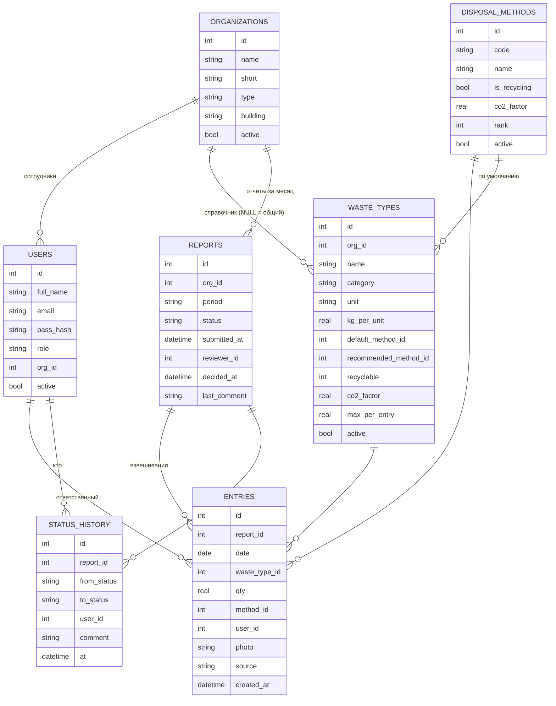

# Wasteless — цифровая система управления пищевыми отходами (АО «АТУ»)

MVP для трека 1 хакатона ATU «Smart Food Industries». Система заменяет бумажные журналы учёта пищевых отходов АО «АТУ». Ответственное лицо вносит взвешивание со смартфона, отчёт проходит проверку и попадает в единый реестр. Из реестра строятся аналитика и сводный отчёт в Excel. Модуль **«Автовыводы»** сам формулирует выводы и рекомендации по введённым данным.

**Презентация:** [PDF](presentation/Wasteless_Youngsters_трек1.pdf) · [PPTX](presentation/Wasteless_Youngsters_трек1.pptx) (12 слайдов, 16:9, заметки докладчика в PPTX).

## Запуск (2 минуты)

Нужен Node.js версии 22.13 или новее (используется встроенный SQLite, без нативных зависимостей).

```bash
npm install
npm start
```

- Компьютер: http://localhost:3000
- Смартфон в той же Wi-Fi-сети: адрес `http://<IP-ноутбука>:3000`, сервер печатает его при старте. Его же кодирует QR-код организации (Администрирование → Организации → «QR-код формы»).
- При первом запуске база заполняется демо-данными автоматически.
- Сбросить демо-данные **перед защитой**: `npm run seed`.
- Публичная ссылка (необязательно): `npx cloudflared tunnel --url http://localhost:3000`.

## Демо-логины (пароль у всех `demo123`)

| Роль | E-mail | Что видит |
|---|---|---|
| Ответственное лицо, столовая «Искандер» | iskander@atu.kz | форма своей организации, свои отчёты, своя аналитика |
| Ответственные лица других организаций | tpp@atu.kz, thipp@atu.kz, inn@atu.kz, canella@atu.kz | то же |
| Проверяющий (эколог) | reviewer@atu.kz | очередь отчётов, приём и возврат, реестр, сводный отчёт, аналитика, контроль сдачи |
| Руководство | director@atu.kz | аналитика, реестр, сводный отчёт, контроль сдачи |
| Администратор | admin@atu.kz | организации, пользователи, справочники, QR-коды, а также всё, что видит проверяющий |

На странице входа есть кнопки быстрого входа под каждую роль.

## Сквозной сценарий (раздел 9 ТЗ, ≈ 2 минуты)

1. **Смартфон:** отсканировать QR столовой и нажать «Столовая „Искандер“». Откроется форма, дата и ответственный подставлены автоматически.
2. Внести 2–3 взвешивания: выбрать вид, ввести вес, нажать «Сохранить». Блоки «Сегодня» и «За месяц» пересчитываются сразу.
3. Нажать «＋ Новый вид» и добавить, например, «Хлебные остатки». Вид сохраняется в справочник организации.
4. Нажать «Отправить на проверку». Статус станет «отправлено», форма заблокируется.
5. **Ноутбук, проверяющий:** открыть «Отчёты» и выбрать отчёт. Статус сменится на «на проверке». Блок «Автопроверка» покажет отклонение от среднего, дубли, пропущенные дни и новые виды. Вернуть отчёт с комментарием.
6. **Смартфон:** появится красная плашка с комментарием. Исправить запись (✎) и отправить снова.
7. **Проверяющий:** принять отчёт. В «Истории изменений» видны все переходы.
8. «Реестр»: фильтры по организации, периоду, виду отходов и способу утилизации.
9. «Аналитика»: KPI, «Автовыводы», 4 графика, таблица отклонений.
10. «Сводный отчёт» → «Квартал» → «Скачать Excel». Ещё есть «Печать / PDF».
11. «Контроль сдачи»: кто не сдал отчёт за период, плюс матрица статусов за 6 месяцев.

## Что реализовано (соответствие ТЗ)

| ФТ | Реализация |
|---|---|
| 1.1–1.4 | Шаблон формы на каждую организацию с её видами отходов. Новый вид добавляется прямо из формы. Дата и ответственный подставляются автоматически. Единица (кг/л) берётся из вида отхода |
| 1.5 | Итоги за день и за месяц считаются из записей и нигде не хранятся |
| 1.6 | Сервер проверяет: значение > 0, верхний предел для вида отхода, дата не в будущем, обязательные поля. Есть предупреждение о вероятном дубле (HTTP 409 → подтверждение) |
| 2.1–2.5 | Mobile-first вёрстка от 360 px. Виды отходов выбираются плитками, для веса открывается числовая клавиатура. Черновик автосохраняется в localStorage. Фото прикрепляется с камеры со сжатием до 1024 px. QR-код ведёт на форму организации |
| 3.1–3.5 | Отчёт за месяц отправляется одним действием. Статусы: черновик → отправлено → на проверке → принято / возвращено. Возврат без комментария невозможен. Принятый отчёт блокируется. Полная история переходов |
| 3.6 | Напоминание о сроке сдачи (до 5-го числа) в форме. Матрица сдачи для проверяющего |
| 4.1–4.3 | Реестр организаций. Новая организация подключается через интерфейс, без кода. Есть регистрация, вход, 4 роли, привязка к организации |
| 5.1–5.5 | Единый реестр (только принятые отчёты) с фильтрами. Сводный отчёт за месяц, квартал или год. Excel по структуре действующих таблиц АТУ, PDF через печать. Контроль несдавших |
| 6.1–6.5 | Графики: динамика по организациям, структура по видам, сравнение организаций, доля переработки, способы утилизации. Сравнение месяц к месяцу и квартал к кварталу. Доля пригодного к переработке и фактически переработанного. Отклонения > 30 %. CO₂-эквивалент |

**Безопасность (НФТ-3).** Права разграничены на сервере: middleware `auth(...roles)` на каждом эндпоинте, ответственное лицо видит только свою организацию. Пароли хранятся как хэш scrypt с солью. Сессия передаётся в cookie с флагами HttpOnly и SameSite=Lax.

**Интерфейс на двух языках:** переключатель РУС / ҚАЗ для основных элементов.

## ИИ-слой (Claude): заключение и ввод фразой

Принцип: **числа считают правила, ИИ только формулирует и распознаёт.** Если ИИ недоступен, система переходит в запасной режим, и экран никогда не остаётся пустым.

| Функция | Как работает | Без ключа API / при сбое |
|---|---|---|
| **Заключение для руководства** (дашборд, сводный отчёт, лист Excel «Автовыводы») | Агрегаты (без ФИО) уходят в Claude как JSON с запретом добавлять новые числа. Ответ кэшируется в БД | Заключение собирается из правил «Автовыводов» |
| **Быстрый ввод фразой / голосом** («отходы из зала 12 кило, масло 3 литра») | Claude сопоставляет фразу со справочником организации, человек проверяет превью и сохраняет | Разбор по ключевым словам и числам (граммы переводятся в кг) |
| **Электронные весы (API, стык с треком 2)** | `POST /api/scale/entries`, заголовок `X-Device-Token`, тело `{"waste_type":"Очистки овощей","weight_kg":12.4}`. Запись попадает в черновик отчёта организации с пометкой «⚖ с весов». В форме есть кнопка-эмулятор «⚖ Весы» | Работает без ИИ |

Подключение ИИ: `ANTHROPIC_API_KEY=... npm start`. Модель задаётся переменной `AI_MODEL`, по умолчанию `claude-opus-5-5`. Используется серверный резерв на случай отказа модели (`fallbacks: "default"`). Голосовой ввод браузера требует HTTPS (туннель). По `http://IP` можно пользоваться диктовкой с клавиатуры телефона.

Демо-токены весов: `demo-scale-<id организации>` (пересоздаются `npm run seed`). В БД хранится только хэш токена.

## Telegram-бот для ответственных лиц

Взвешивание можно внести прямо из Telegram, без открытия сайта.
1. Создайте бота у @BotFather. В файл `.env` в корне проекта добавьте строку `TELEGRAM_BOT_TOKEN=...` (файл в `.gitignore`) и перезапустите сервер. Бот работает через long polling, поэтому ему не нужны публичный адрес и HTTPS.
2. Ответственное лицо в форме ввода нажимает «Telegram-бот → Подключить». Откроется бот с одноразовым кодом (действует 15 минут), и аккаунт привяжется.
3. Дальше достаточно писать боту фразу: «отходы из зала 12 кг, масло 3 литра». Бот покажет распознанное (через ИИ или по ключевым словам) с кнопками «✅ Сохранить / ✖ Отмена». Записи попадают в тот же черновик отчёта с пометкой «✈ Telegram».
4. Команды: `/itogi` — итоги за день и месяц, `/send` — отправить отчёт на проверку, `/help` — подсказка.
5. Уведомления: бот сообщает, когда отчёт возвращён (с комментарием проверяющего) или принят. В 17:00 по Алматы он напоминает, если за день ещё нет взвешиваний.

## Данные под рукой

- **«Моя сводка»** — главный экран ответственного лица. На нём итоги за сегодня, за 7 полных дней (со сравнением с прошлой неделей) и за месяц, CO₂ и статус отчёта. Есть график по дням, топ видов отходов и кнопки «Отчёт за месяц / неделю» (Excel).
- **Реестр:** быстрые периоды одним тапом (неделя, этот или прошлый месяц, этот или прошлый квартал, год). Кнопки **«Excel по фильтру»** (журнал и итоги по видам) и **«CSV для BI»** (`;`, UTF-8, открывается в Excel, Power BI и Google Sheets; защищён от формул в ячейках).
- **Бот:** `/week` и `/quarter` показывают итоги, топ-3 и сравнение с прошлым периодом. `/report` присылает Excel прямо в чат: ответственному — журнал за месяц, проверяющему и руководству — сводный отчёт за квартал. Проверяющий и руководство тоже могут подключить бота и видят сводки по всем подразделениям.

## Облако: Railway

Репозиторий подключён к Railway: каждый push в `main` автоматически пересобирает и перезапускает сервис.
- Нужен Node.js 22: версия закреплена в `.node-version` и `engines`. Порт берётся из `PORT`.
- За прокси Railway сервер сам доверяет `X-Forwarded-*`, поэтому HTTPS, cookie `Secure` и QR-коды работают с публичным доменом. При желании адрес можно задать явно переменной `PUBLIC_URL`.
- Переменные окружения задаются в Railway → Variables: `TELEGRAM_BOT_TOKEN`, при необходимости `ANTHROPIC_API_KEY` и `PUBLIC_URL`. Файл `.env` в репозиторий не попадает.
- **Бот может работать только в одном месте.** Если токен задан и на Railway, и на ноутбуке, Telegram отдаёт ошибку 409, и один из экземпляров ждёт. На ноутбуке бота можно отключить строкой `TELEGRAM_BOT_DISABLED=1` в `.env`. На Railway у мини-приложения постоянный HTTPS-адрес, туннель не нужен.
- Диск Railway временный: при каждом деплое база создаётся заново и заполняется демо-данными. Для пилота нужен Volume, смонтированный в `/app/data`, или PostgreSQL в облаке РК.

## Доступ с любого устройства (публичный HTTPS)

```bash
npm start
```
```bash
npm run tunnel
```
`npm run tunnel` запускает cloudflared quick tunnel и печатает адрес вида `https://….trycloudflare.com`. Сайт открывается с любого телефона или ноутбука, в том числе через мобильный интернет. QR-коды организаций автоматически ведут на адрес туннеля, cookie сессии получает флаг `Secure`. Постоянный адрес можно задать в `.env` строкой `PUBLIC_URL=https://…`.

Пока туннель открыт, система публична, а демо-пароли известны. Держите его открытым только на время показа и закройте (Ctrl+C) после. Для пилота нужен хостинг в РК, PostgreSQL и HTTPS-домен (закон РК о персональных данных).

## Мини-приложение в Telegram и лендинг

- **Мини-приложение.** Пока сервер открыт по HTTPS (`npm run tunnel` или `PUBLIC_URL`), у бота появляется кнопка меню «Wasteless» и команда `/app`. Система открывается прямо внутри Telegram, и вход происходит автоматически: сервер проверяет подпись Telegram (`initData`, HMAC-SHA256 с токеном бота), пароль не нужен. Открыть приложение может только пользователь, чей Telegram привязан к аккаунту. Адрес туннеля бот подхватывает сам при первом HTTPS-запросе.
- **Лендинг `/welcome`.** Публичная страница продукта в стиле cadence: тёмный фон, один голубой акцент, Geist, карточка продукта, которая выпрямляется при прокрутке, живой список взвешиваний, бенто-блоки возможностей, сценарий из четырёх шагов и цифры эффекта. Ссылка «О системе» на экране входа ведёт на него.

## Мобильная версия и установка на телефон

Сайт можно установить на телефон как приложение (PWA): в браузере выберите «Добавить на главный экран», появится иконка Wasteless, и приложение откроется во весь экран. Шрифт полей ввода 16 px, поэтому iOS не приближает страницу при вводе. На телефоне есть нижняя навигация, плитки видов отходов, цифровая клавиатура для веса, ввод фразой, камера для фото, вибрация при сохранении и вход по QR-коду организации.

## Модуль «Автовыводы» (как система делает выводы)

Это правила над данными реестра в `analytics.js`, без «чёрного ящика»: каждый вывод воспроизводим и объясним жюри.

| Правило | Пример вывода |
|---|---|
| Итог и прогноз | «Образовано 12,3 т (≈100 кг/день), CO₂ ≈ 8,6 т; годовой прогноз — 36 т» |
| Динамика (по среднесуточному, сравниваются только организации с данными в обоих периодах) | «окт 26 к сен 26: −1,9 %» |
| Главные источники + рекомендация по ключевым словам | «Пищевые отходы из зала — 39 %… уменьшить базовую порцию гарнира» |
| Отклонения: объём вида отхода на рабочий день выше среднего за 3 мес. более чем на 30 % | «ATU INN: остатки нереализованной продукции +62 % (≈106 кг сверх нормы)» |
| Разрыв переработки | «Пригодно 38 %, перерабатывается 3 % → −9,5 т CO₂-экв. в год» |
| Финансовые потери (допущение 1 500 ₸/кг, задаётся `UNSOLD_PRICE_KZT`) | «Нереализованная продукция ≈ 2,6 млн ₸» |
| Пиковый день недели | «Больше всего отходов в понедельник (+22 %)» |
| Цель ЦУР 12.3 | «Чтобы сократить вдвое к 2030 г., снижать на ≈12,5 % в год» |
| Несданные отчёты | «За октябрь нет принятого отчёта: Кофейня Canella» |

Для проверяющего есть отдельная **автопроверка отчёта**: сравнение со средним организации, рост по видам отходов, дубли, пропущенные рабочие дни, новые виды, число записей с фото. Выводы попадают и в Excel (лист «Автовыводы»).

## Архитектура

```
Смартфон / ноутбук (SPA, vanilla JS + Chart.js)
        │  HTTPS/HTTP, JSON, cookie-сессия
        ▼
Node.js + Express (server.js)
  ├─ auth + роли (сервер)        ├─ analytics.js — реестр, сводка, дашборд, автовыводы, автопроверка
  ├─ API форм/отчётов/статусов    └─ export.js — Excel (exceljs) по структуре таблиц АТУ
        ▼
SQLite (node:sqlite, data/waste.db) + data/uploads (фото)
```

### ER-диаграмма



Правила модели: итоги вычисляются из записей. Реестр — это записи отчётов со статусом `accepted`. Вид отхода, по которому есть записи, нельзя удалить, только деактивировать. Литры пересчитываются в кг через `kg_per_unit` (масло — 0,92).

## Справочник организаторов и CO₂

Виды отходов, способы утилизации и коэффициенты берутся из официального файла организаторов `reference/Справочники_Трек1.xlsx` (DEFRA / BEIS 2024, раздел Waste disposal). При первом запуске и при `npm run seed` файл загружается автоматически. Любой справочник того же формата можно загрузить в интерфейсе: «Администрирование → Настройки и справочники → Загрузить .xlsx». Повторная загрузка обновляет записи и ничего не дублирует.

- **Формула (из справочника):** CO₂ = масса (т) × коэффициент. При вывозе ТБО берётся коэффициент вида отхода (пищевые 700,21; картон 1 164,39; стекло 8,88 кг CO₂e/т), иначе — коэффициент способа (компост и биогаз 8,88; переработка и масло 6,41). Экономия = масса × (коэф. ТБО − коэф. рекомендуемого способа). Масло: л × 0,92 = кг.
- **Иерархия обращения с отходами:** 1 — передача / фудшеринг, 2 — корм животным, 3 — переработка / масло, 4 — компост / биогаз, 5 — полигон. В форме подсказка «🌱 Рекомендуется: …» показывает, сколько CO₂ экономит лучший способ, и переключает на него одним касанием.
- **Пригодность к переработке:** «да / частично / нет», как в справочнике. Мясо и кости — «частично» (только биогаз).
- У способов «Передача на корм» и «Фудшеринг» коэффициента DEFRA нет. Для них выбросы считаются равными 0, это допущение.

## Масштабирование на другие отрасли

Система не привязана к университету. В разделе «Администрирование → Настройки и справочники» можно:
- **выбрать отрасль:** университет / кампус, пищевое производство (цеха), общепит и HoReCa (заведения), розничная торговля (магазины). Меняется терминология во всём интерфейсе, а шаблон добавляет типовые виды отходов с рекомендуемыми способами и коэффициентами CO₂;
- **задать название системы, организацию-владельца и как называть подразделение**;
- **загрузить свой справочник из Excel**.

Новое подразделение подключается без кода: администратор добавляет его, выдаёт QR-код и, при необходимости, токен электронных весов.

## Демо-данные

`seed.js` загружает справочник организаторов и воспроизводимо (фиксированный seed) генерирует взвешивания за 4 закрытых месяца и текущий месяц по всем 5 организациям. Способ «как сейчас» — вывоз ТБО (как в образцах таблиц АТУ), частично уже работают компост, вторсырьё, сдача масла и фудшеринг. В данные заложено:

- сезонность: летом кафедры ведут 1 лабораторное занятие в неделю, общепит загружен меньше;
- пик по понедельникам в столовой;
- рост отходов из зала в столовой «Искандер»;
- аномалия у ATU INN: остатки нереализованной продукции в прошлом месяце ×1,75 (банкеты);
- отчёт кофейни за прошлый месяц не проверен (для контроля сдачи);
- у ТХиПП в истории есть возврат с комментарием.

Пример сводного отчёта за квартал: `docs/Сводный_отчёт_3_квартал_2026.xlsx`.

## Библиотеки и инструменты

- Навык bs-cadence-marketing-landing (Skillry) — дизайн-система лендинга; шрифты Geist и Geist Mono (fontsource, OFL); Telegram Web App SDK (telegram.org) — только внутри мини-приложения.
- cloudflared (Cloudflare, Apache 2.0) — туннель для публичного HTTPS-доступа во время демо.
- Express 4 (MIT), exceljs (MIT), qrcode (MIT), Chart.js 4 (MIT), anime.js 3.2.2 (MIT, анимации интерфейса, локально в public/vendor), шрифт Manrope (Google Fonts, OFL). SQLite встроен в Node.js.
- Сервисы: Claude API (Anthropic, SDK `@anthropic-ai/sdk`, MIT). Используется внутри продукта для заключения и разбора фразы, работает только при заданном ключе.
- ИИ-инструменты разработки: Claude Code (Anthropic) и агенты из набора хакатона в `.claude/agents` (на основе everything-claude-code, лицензия в `.claude/ECC-LICENSE`): planner, code-reviewer, deliverables-checker, impact-calculator. Применялись как вспомогательные инструменты для кода, ревью и проверки расчётов. Концепция, расчёты и защита — работа команды.

## Структура

```
server.js      API, роли, статусы отчётов, валидация, весы, ИИ
reference.js   импорт справочника из Excel, отраслевые шаблоны, настройки
ai.js          заключение и разбор фразы (Claude) с запасным режимом по правилам
reference/     справочник организаторов (виды отходов, способы, CO₂)
db.js          схема БД, хэширование паролей
analytics.js   реестр, сводка, дашборд, автовыводы, автопроверка
export.js      выгрузка в Excel
seed.js        демо-данные
public/        интерфейс (index.html, app.js, styles.css, vendor/chart.js)
docs/          пример сводного отчёта за квартал
```
